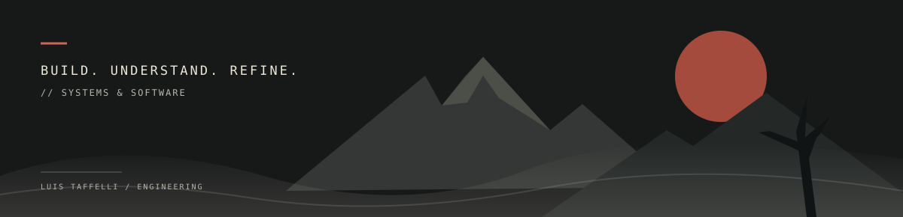

# Luis Taffelli

**Software Engineer · Backend & Distributed Systems**

I build backend services and automation systems, with a focus on reliability, scalability and maintainability. My main stack is Node.js and JavaScript. I enjoy understanding how software works internally and making complex workflows simpler.

```text
> focus
backend / distributed automation / protocols & Android
```

## Engineering focus

**01 / Backend**  
Scalable services, REST APIs and performance optimization.

**02 / Distributed automation**  
Distributed systems, data extraction and large-scale automation workflows.

**03 / Protocols & Android**  
Reverse engineering, protocol analysis and Android instrumentation with emulators and physical devices.

## Selected tools

`Node.js` · `JavaScript` · `Git` · `Frida` · `Smali`

---

[Get in touch](mailto:luistaffelli@gmail.com)
