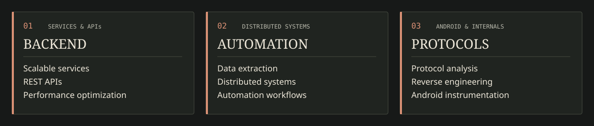
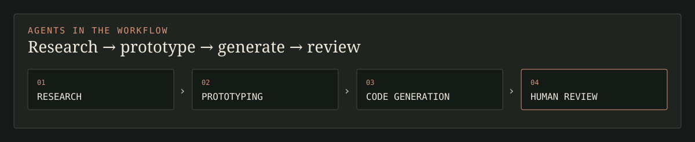
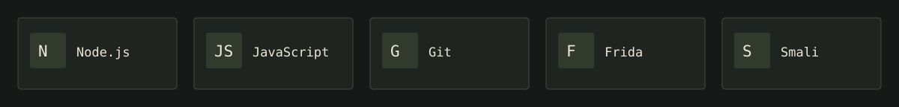
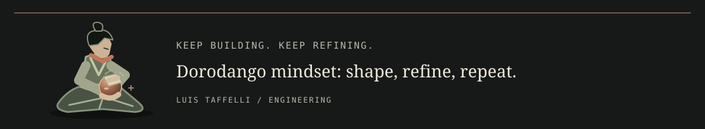

  

# Luis Taffelli

**Software Engineer · Backend, Automation & AI Integrations**

[Engineering focus](#engineering-focus) · [AI workflow](#ai-workflow) · [Selected tools](#selected-tools) · [Contact](#contact)

I build backend services and automation systems, with a focus on reliability, scalability and maintainability. My main stack is Node.js and JavaScript. I enjoy understanding how software works internally and making complex workflows simpler. I integrate AI agents into my development workflow for research, prototyping and code generation, with human review and validation.

## Engineering focus

Explore the three specialties

- **Backend:** scalable services, REST APIs and performance optimization.
- **Distributed automation:** distributed systems, data extraction and large-scale automation workflows.
- **Protocols & Android:** reverse engineering, protocol analysis and Android instrumentation with emulators and physical devices.

## AI workflow

> I integrate AI agents into my development workflow for research, prototyping and code generation, with human review and validation.

## Selected tools

`Node.js` · `JavaScript` · `Git` · `Frida` · `Smali`

## Contact

[Get in touch — luistaffelli@gmail.com](mailto:luistaffelli@gmail.com)

Dorodango mindset: shape, refine, repeat.
